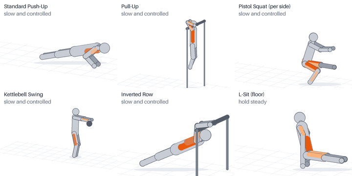

# Calisthenics App

A personal Android app for bodyweight and equipment-assisted training. Its library contains533 exercise, stretch and warm-up variations, with explicit progression paths toward skills such as the muscle-up, front lever and pistol squat. It runs fully offline: no account, no internet permission, and all data stays on the phone. Demonstrations that need improvement are withheld, with written instructions available instead.



I built it as the product owner. AI coding agents wrote most of the code; I set the scope, made the decisions, reviewed the results and tested on my phone. The repository shows the app and also how the work was run: specification, ordered workplan, decision log, approval gates and evidence for every step.

## What the app does

**R8.5 candidate (0.11.5-r8):** changing the exercise count rebuilds a session without automatic alternatives duplicated; manual choices persist until the count changes. Empty Preview deletion has Add/Undo recovery. Five reviewed video candidates are updated, with the unresolved ring experiment withheld. 539 domain, 256 app and 238 Python tests pass; phone checks and form acceptance remain open. [Release evidence](docs/evidence/r8.5-implementation-2026-10-25.md) · [Video procedure](docs/39-video-generation-and-review-procedure.md). Content DRAFT.

**R8.4 candidate (0.11.4-r8):** synchronized Flow / Rest / Stretch in Train and both Previews, ordinary App-level defaults preserving saved rules, demonstrated higher-level adoption (success 1/3, then two further qualifying days), conservative N−1 estimates for compatible untried same-rung alternatives, media-routed warning cues and a visible-workout screen-awake policy. Fresh verification passes 539 domain and 252 app tests, lint, build and content checks. Physical audio/music/manual-lock checks, upgrade acceptance and screenshots remain open. [Implementation and build evidence](docs/evidence/r8.4-implementation-2026-10-20.md) · [Phone checklist](docs/evidence/owner-check-r8.4.md). Content DRAFT.

**R8.3 candidate (0.11.3-r8):** quieter saved app volume, music-friendly cue configuration, Flow / Rest / Stretch on Train, adjustable upcoming preparation, personal level targets and rep/hold targets beyond level 5, static Pilates/Conditioning cards, and an ultramarine Light appearance with yellow stars. Fresh-checkout tests, lint and build pass; screenshot review, physical music/Bluetooth checks and owner acceptance remain open. [Implementation evidence](docs/evidence/r8.3-implementation-2026-10-20.md) · [Phone checklist](docs/evidence/owner-check-r8.3.md). Content DRAFT.

**R8.2 (0.11.2-r8):** power exercises sit in Squat and Push (no Power tab), Prehab and warm-up items are one Warm-up category with an automatic matched warm-up, Train has an Include row (Warm-up, Conditioning, Cool-down) with a conditioning finisher, and the duplicate exercise count is gone. [Phone check](docs/evidence/owner-check-r8.2.md). Not phone-tested; content DRAFT.

**R8.1 (0.11.1-r8):** engine fixes from the owner's R8 phone test (never below the shown level, one exercise per progression, actual reps, 3 good sessions within 14 days), set formats, Flow and persistent edits in the Preview, programs and routines in one dropdown, merged 30+ minute Army and Pilates sessions, search on top and visible alternatives in Progress, equipment icons and order. Walk-through: [phone check](docs/evidence/owner-check-r8.1.md). Not phone-tested; content DRAFT.

**R8 (0.11.0-r8):** expands the library, adds eight fixed programs, equipment-aware selection and searchable aliases, and keeps the main progression paths compact. Completed workouts alternate approved variations; new comparable alternatives receive conservative starting targets, then follow their own results. Preview rests are editable, voice cues are slower and name the working side, and two-sided holds have a five-second changeover. Fixed programs live under Routine; specialist exercises can be added manually in Preview and follow the selected equipment profile. See the [phone walk-through](docs/evidence/owner-check-r8.md). All 25 previously unclear demonstration videos are replaced and no demonstration is withheld. The final APK is verified on CI and in a fresh Docker clone (`docs/evidence/r8-build-2026-10-17.json`). R8 phone checks and owner acceptance remain open; training content remains DRAFT.

- **Train:** pick a goal (a skill such as the handstand push-up, or a body focus), your equipment profile and the number of rounds. You get a circuit preview with the muscles worked; swap any exercise for today or permanently, then start.
- **During the workout:** large timer, looping demo clip, voice cues and a foreground service, so it keeps time with the screen off. Stretches replace passive rest. You log reps on the exercise screen and holds during the following break.
- **Progression:** every exercise has five levels. The app moves you up after three successful sessions within any 14 days (sessions on a same-level alternative count together), holds the level if you fall below target, pauses the whole exercise family if you report pain, and hands you to the next exercise when you master one. Kettlebell levels count per weight: a heavier bell restarts the same exercise, while the same bell leads to harder exercises.
- **Progress:** a skill tree per family (push, pull, squat, core…) with 0–5 stars, locks and equipment badges.
- **History:** a week view and per-workout details, with corrections saved as new revisions so nothing is overwritten.
- **Data:** checksummed backup and restore, crash-safe workout recovery, and a schema-checked database with no destructive migrations.

**Version 2 (release R7, 0.10.0-r7):** R7 adds, on top of R6, rep logging on the exercise screen, an exercises-per-round stepper (aiming for at least 30 minutes when enough equipment-compatible exercises are available), skill sessions built around the skill, a full-timeline editor, an Edit mode and links in Progress, Jefferson curl and German hang, and a cool-down switch; see `docs/evidence/owner-check-r7.md`. Nothing has been tested on a phone and the exercise content is an unreviewed draft.

**Version 2 (release R6, 0.9.0-r6):** a redesigned Train and workout screen, a round preview you can edit (levels, stretches, per-set numbers), three workout formats (circuit, pairs, straight sets), progression rules (levels or rep ranges), saved routines and the ready-made Recommended and Minimalist routines, an optional warm-up, History charts, weight tracks and suggestions for extra equipment, a 24-stretch library with a "Starting To Stretch" session, a RAMP warm-up and the Barlow Condensed and IBM Plex Sans type. See `STATUS.md` and `docs/evidence/owner-check-final.md`. Exercise content is still an unreviewed draft and nothing has been tested on a phone yet.

## How the project was run

| Stage | Where |
|---|---|
| Idea and product specification, approved before coding | `docs/archive/00-owner-idea.md`, `docs/archive/01-product-specification.md` |
| Coding specification, workplan (27 tasks) and verification plan | `docs/02`–`04` |
| Decisions, open risks, architecture records | `docs/archive/07-decisions-and-blockers.md`, `docs/adr/` |
| UX overhaul from my phone feedback: 18 findings, 8 open questions, 14 tasks | `docs/10-ux-overhaul-plan.md` |
| Evidence: a verification log per task, phone-run results, reviews | `docs/evidence/` |
| Honest current state | `STATUS.md` |

Ground rules I set for the agents:

- one small task at a time, with tests first;
- the full verification run before every commit, with its log kept;
- no claims without evidence;
- I approve gates myself; an agent never does.

Every number in the exercise catalog is marked DRAFT until I have reviewed it (`docs/review/draft-numbers.md`).

## Engineering

- **Depth Jump return and moving-ring review:** the new Depth Jump has a higher ballistic rebound, planted turn steps and a direct step back onto the box. The Ring Muscle-Up couples hand and hoop motion, but finger proportions/contact remain flagged and block app promotion. 205 Python tests, native geometry and desktop playback/control checks pass; both are review candidates. [Depth evidence](docs/evidence/depth-return-refinement-2026-10-21.md) · [Ring evidence](docs/evidence/ring-articulation-refinement-2026-10-21.md).

- **Push-Up Burpee knees:** sagittal knee bends, bilateral feet transfers and a short jump with extended takeoff replace the knee flare and floating apex in the review candidate. 179 tests, native geometry and desktop playback checks pass. App media stays unchanged pending review. [Evidence](docs/evidence/burpee-refinement-2026-10-21.md).

- **Depth Jump realism:** shorter gravity-shaped flight, coordinated arms, neutral wrists and takeoff extension replace the floating jump. 169 tests and native geometry/desktop playback checks pass; eight rendered review candidates are ready. [Evidence](docs/evidence/depth-jump-refinement-2026-10-21.md).

- **Video generation lessons and next batch:** six refined motions and two accepted regression controls are staged in an isolated native Blender batch. 162 Python tests and ten movement contracts pass; rendered candidates require full playback and form review before replacement. [Lessons and workflow](docs/38-video-generation-lessons-and-batch.md).

- **Straddle Press feet:** continuous toe rotation, a pointed finish and a complete eight-second rise/return replace world-fixed feet and the loop reset. 105 Python tests and actual foot geometry checks pass; wrist/hand realism is added to the review workflow. [Results](docs/evidence/straddle-foot-refinement-2026-10-21.md).

- **Bar pullover smoothing:** an eleven-second continuous rollover and slower reverse replace the abrupt quarter-turn timing. 94 Python tests and full-frame geometry checks pass; phone/form review remains open. [Results](docs/evidence/bar-pullover-refinement-2026-10-20.md).

- **Catalog screening:** all 533 videos decode; 111 have timing review prompts. Three Luna lanes helped prepare eight complex movements for owner review. This is screening, not library-wide form approval. [Workflow and evidence](docs/37-catalog-motion-screening.md).

- **Pull-up pacing:** steady central travel with smooth endpoint ramps now catches and fixes the remaining speed surge. 72 Python tests pass. [Results](docs/evidence/pullup-steady-pace-2026-10-20.md).

- **Pull-up follow-up:** continuous movement through intermediate poses and fingers wrapped around the bar with collision checks; the approved archer assets are unchanged. [Results](docs/evidence/pullup-smooth-grip-2026-10-20.md).

- **Motion-quality pilot:** scripted movement checks reject the old archer push-up and vertical pull-up; corrected source clips use a continuous torso mesh and reference comparisons with cached extraction. Two exercises are scoped; phone/form acceptance remains open. [Results](docs/evidence/motion-quality-pilot-2026-10-20.md) · [Run the workflow](docs/36-motion-quality-pilot.md).

- **Hand-detail pilot:** chin-up/pull-up Blender renders distinguish palm direction with detailed hands and enlarged grip views. Automated screening uses three reference videos per exercise; camera/visibility limits and owner phone readability remain open. [Evidence](docs/evidence/blender-grip-pilot-2026-10-20.md) · [Tooling](tools/blender/FORM_REVIEW.md).

- Kotlin and Jetpack Compose (Material 3), Room, and a foreground service; minimum Android 8.0 (API 26). Built on the open-source [CalisthenicsMemory](https://codeberg.org/Gonbei774/CalisthenicsMemory) app (GPL-3.0), whose old screens were replaced.
- Three modules:
  - `domain`: pure Kotlin, holding the planner, progression engine and session state machine, all deterministic and unit-tested;
  - `data`: storage;
  - `app`: the user interface.
- **Automated tests** covering domain logic, catalog rules, and Robolectric UI tests at phone size, at text size 1.3 and in dark mode. Lint, an offline build check and a hygiene check run in CI (`.github/workflows/android.yml`).
- The exercise catalog and demo clips are generated from scripts, so content changes are reviewable as code: the catalog by `tools/gen_starter_catalog.py`, the clips as poses in `tools/blender/` rendered in Blender. `tools/gen_demo_clips_v3.py` (the earlier stick-figure generator) still writes the muscle data (`clip_meta.json`) and checks that every exercise has a pose.

## Build

```sh
bash scripts/verify.sh            # tests, lint, debug APK, content validation (JDK 21 + Android SDK 35)
./gradlew :app:assembleDebug      # APK in app/build/outputs/apk/debug/
```

## Status

The app is in personal use on a Galaxy S21. The latest UX overhaul is verified by the automated tests but not yet fully re-tested on the phone. The training numbers are not yet professionally reviewed. Licensed under GPL-3.0 (see `LICENSE`, `THIRD_PARTY_NOTICES.md` and `PRIVACY.md`).
