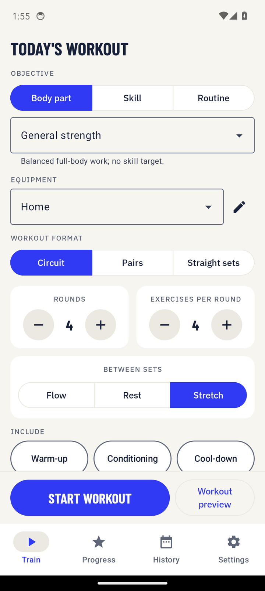
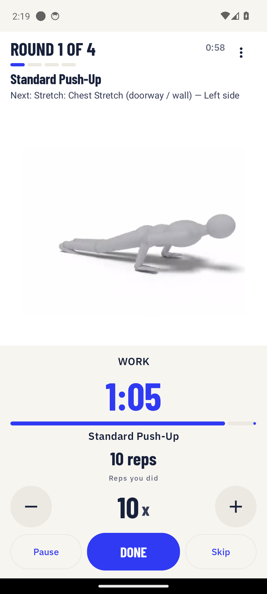
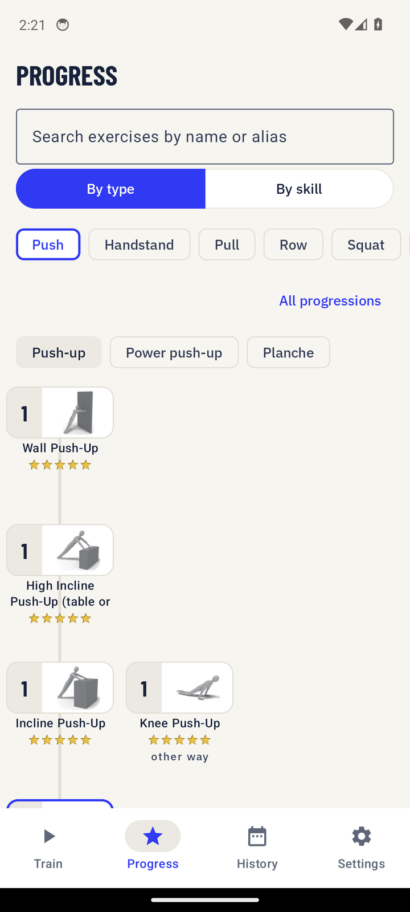

# Calisthenics App

A personal training app that turns bodyweight and equipment-assisted exercises into structured workouts, with guided sessions, adaptive progression and a clear record of progress.

Built for Android and the web with Kotlin Multiplatform and Compose Multiplatform.

**Latest version: 9.3** · `0.12.3-r9` · November 2026

[Version 9.3 source](https://github.com/Nilscost/Calisthenics-app/tree/codex/kmp-port) · [Release notes and status](https://github.com/Nilscost/Calisthenics-app/blob/codex/kmp-port/STATUS.md)

<p align="center">
  
  
  
</p>

<p align="center"><em>Plan your workout · Follow a guided session · Track your progress</em></p>

## The app

The app brings workout planning, exercise guidance and progression tracking into one place. Its library covers 533 exercise, stretch and warm-up variations, with progression paths toward skills such as the muscle-up, front lever and pistol squat.

- **Personalised workouts:** choose a skill or body focus, select your equipment and adjust the session before you start. Save routines or use ready-made programs.
- **Guided training:** follow demonstration clips, timers and voice cues, with optional warm-ups, conditioning and cool-downs.
- **Adaptive progression:** work through five levels per exercise, build consistency across sessions and move toward harder variations as you progress.
- **Visible progress:** explore skill trees, review exercise history and correct workout logs without losing the original record.
- **Local data:** keep your history, routines and settings on your device, with backup and restore. The Android app runs fully offline; the web app works offline after loading, with demonstrations cached as they are used.

## What’s new in 9.3

Version 9.3 focuses on making workouts easier to follow and progress easier to understand:

- **Clearer repetition counts:** alternating exercises show both the total and the count per side.
- **A more useful preparation screen:** the next exercise, its target and the working side take priority.
- **Simpler workout feedback:** one card per exercise brings together results, corrections and difficulty feedback, with clearer explanations of level changes and the next progression.
- **Smaller steps between levels:** targets increase gradually after successful sessions.
- **Routine import from a chatbot:** export the exercise library and routine format, then import a generated routine from a file or pasted text.
- **Refined demonstrations:** nine exercise clips were rebuilt and reviewed against filmed coaching references.

## My role

I built this project as the product owner, starting from an open-source Android app. I defined the product direction, translated my own training needs into requirements, prioritised improvements and tested the app on my phone. AI coding agents wrote most of the code; I directed their work, reviewed the results and made the product decisions.

The repository documents that process: specifications, architecture decisions, feedback-driven iterations and verification evidence. It shows how I take a practical problem from an initial idea through implementation, testing and continued refinement.

## Technical overview

| Area | Implementation |
| --- | --- |
| Shared application | Kotlin Multiplatform and Compose Multiplatform |
| Android | Jetpack Compose, Room and a foreground workout service; Android 8.0+ |
| Web | Kotlin/WebAssembly, shared Compose UI and offline caching |
| Training logic | Deterministic workout planning, progression and session state |
| Content | Script-generated exercise catalog and Blender-rendered demonstrations |
| Verification | JVM and WebAssembly tests, Android UI tests, browser checks, lint and content validation |

The code is organised into `domain` (training logic), `data` (storage), `shared` (shared interface), `app` (Android) and `web` (browser).

## Build and explore

Version 9.3 is on the [`codex/kmp-port` branch](https://github.com/Nilscost/Calisthenics-app/tree/codex/kmp-port). The default branch currently contains an earlier implementation.

```sh
git clone --branch codex/kmp-port https://github.com/Nilscost/Calisthenics-app.git
cd Calisthenics-app

# Build the Android debug APK
./gradlew :app:assembleDebug

# Build the web app
./gradlew :web:wasmJsBrowserDistribution

# Run the host verification suite
bash scripts/verify.sh
```

See the [toolchain requirements](https://github.com/Nilscost/Calisthenics-app/blob/codex/kmp-port/toolchain.lock.md) for Java, Android SDK, Node.js and Python versions.

For a closer look at the work, start with the [documentation index](docs/README.md), or explore:

- [Product specification](https://github.com/Nilscost/Calisthenics-app/blob/codex/kmp-port/docs/archive/01-product-specification.md)
- [Multiplatform architecture and implementation](https://github.com/Nilscost/Calisthenics-app/blob/codex/kmp-port/docs/evidence/kmp-port.md)
- [User feedback and iterations](https://github.com/Nilscost/Calisthenics-app/blob/codex/kmp-port/docs/user-feedback.md)
- [Version 9.3 interface review](https://github.com/Nilscost/Calisthenics-app/blob/codex/kmp-port/docs/evidence/ui/R9.3-review.md)

## Project status

This is a personal project in active development, used on a Samsung Galaxy S21. Version 9.3 has automated verification and screenshot-review evidence; its release-specific phone checks remain open. Exercise targets remain a draft and have not been professionally reviewed.

## License and acknowledgements

Based on [CalisthenicsMemory](https://codeberg.org/Gonbei774/CalisthenicsMemory) and licensed under [GPL-3.0](LICENSE). See [third-party notices](THIRD_PARTY_NOTICES.md) for attribution and licensing details.
